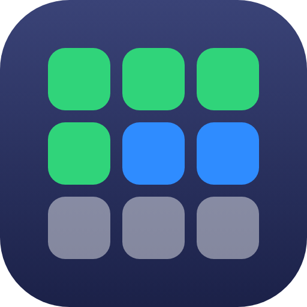
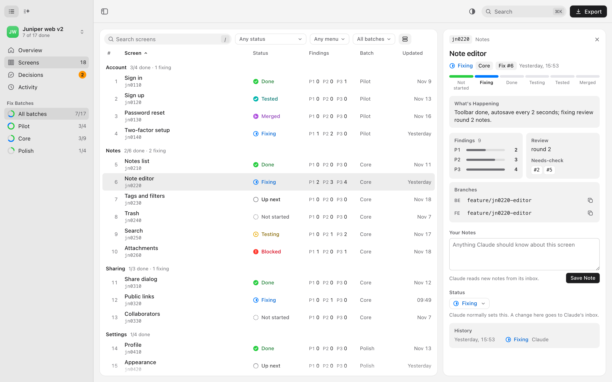
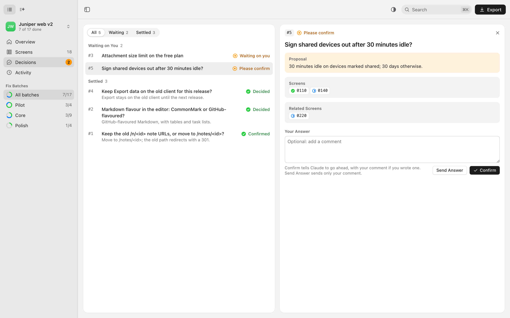
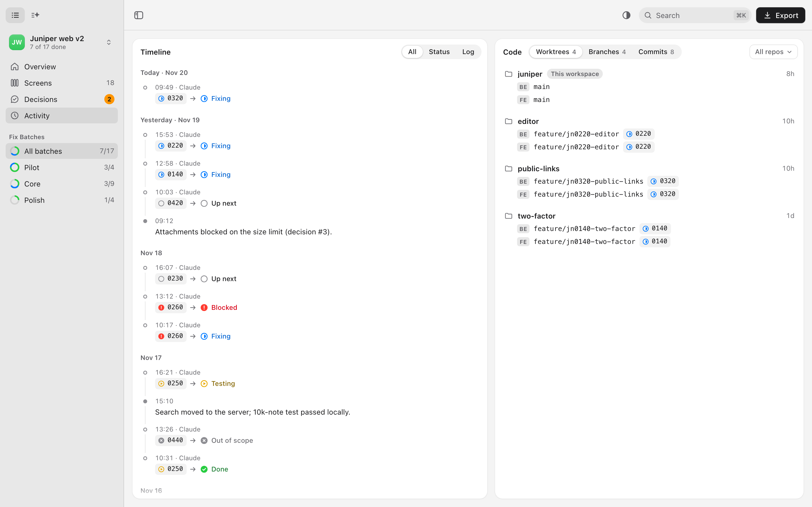
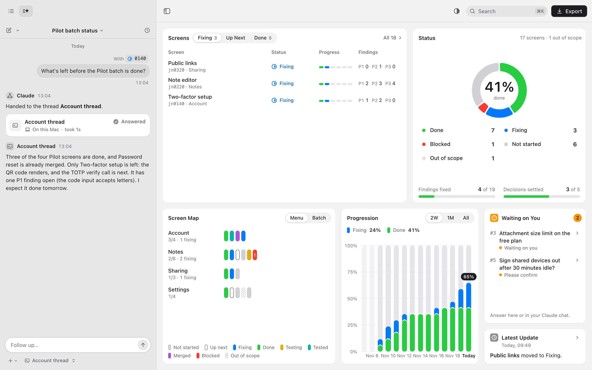
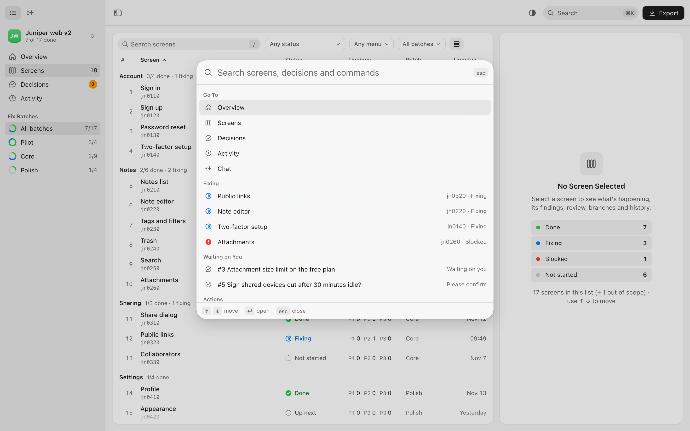
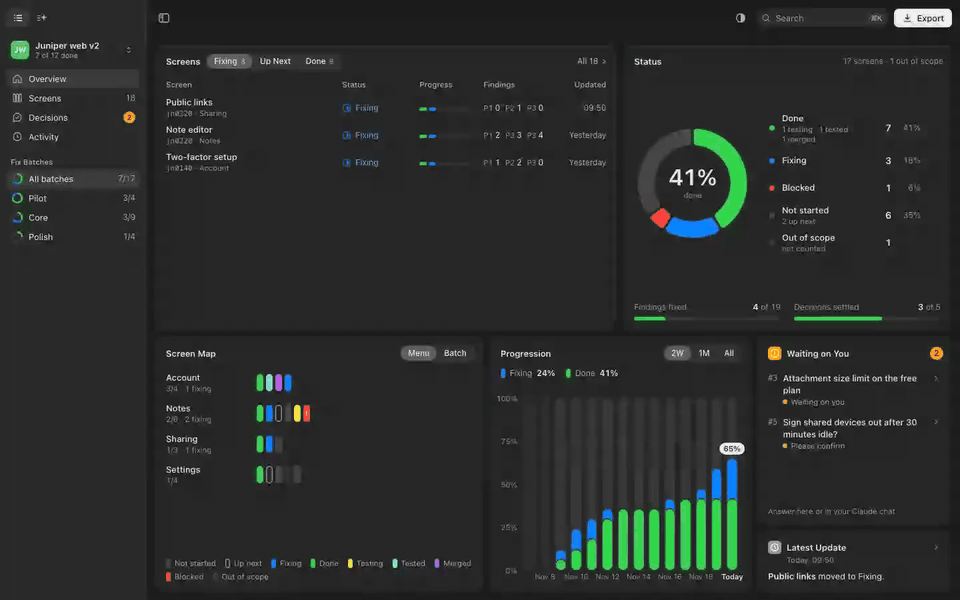
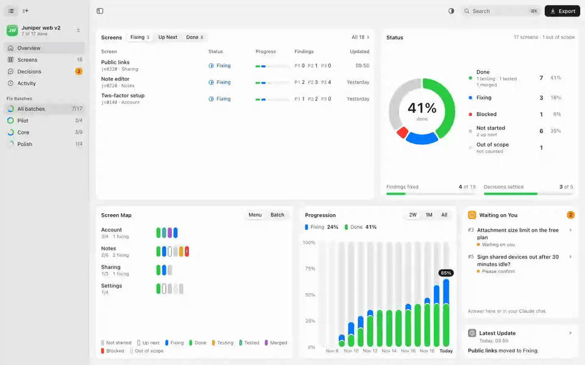
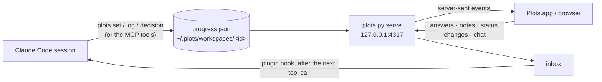

<p align="center">
  
</p>

<h1 align="center">Plots</h1>

<p align="center">
  <strong>Mission control for your Claude Code projects.</strong><br/>
  See what's done, what Claude is working on and what's waiting on you, live, on your Mac.<br/>
  <sub>Claude updates it with one short command per change. You answer its questions, leave notes and chat about the work, and they reach the session even mid-task.</sub>
</p>

<p align="center">
  
  
  
  
  
  
</p>

<p align="center">
  <a href="#features">Features</a> · <a href="#watch-it-work">Watch it work</a> · <a href="#install">Install</a> · <a href="#quick-start">Quick start</a> · <a href="#how-it-works">How it works</a> · <a href="#try-the-demo">Demo</a>
</p>

<p align="center">
  <picture>
    <source media="(prefers-color-scheme: dark)" srcset="docs/assets/overview-dark.png" />
    
  </picture>
</p>

When Claude Code does most of the work on a project (a migration, a rebuild, a long list of pages or endpoints), the
hard part is keeping up: what's done, what's in flight, what Claude is stuck on, which questions it left for you.
**Plots** keeps one live board per project. Claude Code writes to it as it works (`plots set 0140 done -m "Review
passed."`), the Mac app shows each change the moment it lands, and everything you send back (an answer, a note, a
status change, a chat message) goes to the session that's doing the work.

## Features

<table>
<tr>
<td width="40%" valign="middle">

### 🗺 The whole project at a glance

What's being fixed, up next or done; a status wheel; a map of every item by group; progression over two weeks, a
month or all time; the decisions waiting on you; the latest update. Fix batches in the sidebar narrow everything to
one batch.

</td>
<td width="60%">

<picture>
  <source media="(prefers-color-scheme: dark)" srcset="docs/assets/overview-dark.png" />
  
</picture>

</td>
</tr>
<tr>
<td width="40%" valign="middle">

### 🧩 Every item, its whole story

Search, filter and sort the list; select an item to see what's happening now, its findings (P1–P3), review round,
needs-check items, branches and history. Change a status with a click or a key: **S**, then a number.

The process is built in: Not started → Up next → Fixing → Done → Testing → Tested → Merged, plus Blocked and Out of
scope. Testing is yours: Claude never marks something Tested or Merged unless you ask.

</td>
<td width="60%">

<picture>
  <source media="(prefers-color-scheme: dark)" srcset="docs/assets/screens-dark.png" />
  
</picture>

</td>
</tr>
<tr>
<td width="40%" valign="middle">

### 🙋 Decisions waiting on you

Everything Claude asked you, with its proposal. **Confirm** tells it to go ahead; **Send Answer** sends your comment.
Either one lands in the working session's inbox, and the plugin hands it over after the session's next tool call.

</td>
<td width="60%">

<picture>
  <source media="(prefers-color-scheme: dark)" srcset="docs/assets/decisions-dark.png" />
  
</picture>

</td>
</tr>
<tr>
<td width="40%" valign="middle">

### 🌿 Activity and code

A timeline of status changes and log lines, and a **Code** card that reads your repositories with read-only git:
worktrees (one row per folder, with its BE and FE branches), branches (ahead ↑ / behind ↓ the common branch, and
which item each is for) and the shared commits.

</td>
<td width="60%">

<picture>
  <source media="(prefers-color-scheme: dark)" srcset="docs/assets/activity-dark.png" />
  
</picture>

</td>
</tr>
<tr>
<td width="40%" valign="middle">

### ✦ Chat with Claude about the work

Ask "what's left before the Pilot batch is done?" right beside the page; what you're looking at goes with the message.
A fork of the working session answers (it knows everything that session knows, without interrupting it), or your
Claude project's coordinator hands the message to the right thread. `@` mentions an item, `#` a decision.

</td>
<td width="60%">

<picture>
  <source media="(prefers-color-scheme: dark)" srcset="docs/assets/chat-dark.png" />
  
</picture>

</td>
</tr>
<tr>
<td width="40%" valign="middle">

### ⌘K Search everything

Jump to any view, item or decision, or run a command, from one box. Type `30` to open decision #30.
`⌘1`–`⌘4` switch views, `⌘0` opens Chat, `/` searches the list.

</td>
<td width="60%">

<picture>
  <source media="(prefers-color-scheme: dark)" srcset="docs/assets/search-dark.png" />
  
</picture>

</td>
</tr>
</table>

Also: one workspace per project with a switcher, Automatic / Light / Dark appearance, a compact layout for narrow
windows, **Export to Excel**, and `plots undo` for the last 50 changes.

## Watch it work

<p align="center">
  
</p>

<p align="center"><sub>A Claude Code session finishing a screen, recording its commit, closing a batch and asking a question. Each change shows up as it lands.</sub></p>

<p align="center">
  
</p>

<p align="center"><sub>Asking Chat what's blocked. The thread shows it's working, then answers.</sub></p>

## Install

Plots needs **macOS 26** or later, **Python 3.8+** (the one with Xcode's command line tools is fine) and, to build the
Mac app, **Xcode 26**. There is nothing else to install: the engine is stdlib Python and the page is plain
JavaScript and CSS with no build step.

```sh
git clone https://github.com/Zinoo00/plots.git
cd plots
sh install.sh --claude
```

That builds **Plots.app** into `~/Applications`, puts the `plots` command in `~/.local/bin`, and installs the Claude
Code plugin. The app's menu can do the last two as well: **Plots › Install Command Line Tool…** and
**Plots › Install Claude Code Plugin…**.

<details>
<summary>Without the Mac app, or without the plugin</summary>

- **Browser only:** `python3 plots.py open` starts the local server and opens the page at
  [http://localhost:4317](http://localhost:4317). Everything works there too, with the page's own sidebar.
- **Plugin by hand:**
  ```sh
  claude plugin marketplace add ~/.plots/claude-plugin
  claude plugin install plots@plots
  ```
- **Automation** (optional): `sh automation/install.sh` adds an MCP server and hooks that record commits and test runs
  in lane worktrees on their own. See [`automation/README.md`](automation/README.md).

</details>

## Quick start

In a project folder:

```sh
plots init "Juniper web v2" --prefix jn         # one workspace per project
plots add 0110 "Sign in" --menu Account --batch Pilot
plots set 0110 fix -m "Porting the form to the new session API."
plots open
```

Or let Claude Code do it: `/plots:init` makes the workspace and offers to add your list of items. From then on the
plugin tells every session in that folder which workspace it's in, and Claude keeps it current:

```sh
plots set 0110 done -m "Signs in against the v2 API; review passed."
plots decision add "Keep the old /n/<id> URLs?" -s ask -d "Move to /notes/<id> with a 301."
plots commit FE 3e9d1c7f2 "Sign-in form on the session API"
plots log "Pilot batch started."
```

`/plots:status` summarizes where things stand and `/plots:notes` shows what you sent from Chat.

<details>
<summary>Every command</summary>

```
plots                      summary: progress, next items, decisions waiting on you, inbox count
plots next [N]             next items to pick up, by fix order
plots ls [all|open|<status>|@<batch>|<group>]   compact list
plots show <id>            one item in full, with your note and its history
plots decisions [open|settled|all] · plots decision <n>
plots inbox [--peek]       notes, answers and status changes left in the app
plots activity [N] · plots log [-n N] · plots commits [N]
plots code                 worktrees and branches, and how far each is from the common branch

plots set <ids> <status> [-m "what's happening"]
                           ids: 0040 | 0401,0402 | @pilot (a whole batch)
                           status: ns next fix done testing tested merged blocked oos
plots note <ids> "what's happening"
plots detail <id> key=value ...   review= be= fe= report= findings= checks=#2,#9 p1= p2= p3=
plots log "what changed"
plots decision add "topic" [-s ask|wait|decided|confirmed] [-d "proposal"] [--screens ids]
plots decision <n> <status> [-d "decision"]
plots commit <BE|FE> <hash> "message"
plots add <id> "name" --menu M --batch B [--order N]
plots undo

plots ws · plots init ["Name"] [--prefix P] · plots ws use <id> · plots ws set <id> key=value
plots open | serve | stop · plots mcp · plots export [file.xlsx] | import <file.xlsx>
```

Add `--json` to any read. `plots help` prints the full list, including the Chat and bridge commands.

</details>

## How it works



- **`plots.py`**: the engine. CLI, local server and Chat, in one stdlib-only Python file. Each workspace is one JSON
  file; every write takes a lock, keeps an undo snapshot and writes atomically, and the page hears about it over
  server-sent events.
- **`app/`**: the page, vanilla JavaScript and CSS. **`native/`**: the Mac app (AppKit window and toolbar, a SwiftUI
  sidebar, the page in a WKWebView). While the source folder is there the app runs the engine and page from it, so
  only `native/` changes need `sh native/build.sh`.
- **`plugin/`**: the Claude Code plugin: the `plots` skill, `/plots:init`, `/plots:status`, `/plots:notes`, and hooks
  that tell a session which workspace it's in and hand it what you send from the app as it arrives.
- **`automation/`**: an MCP server for agents, and hooks that record lane commits and test results by themselves.

<details>
<summary>Chat: a fork of the working session, or your Claude project</summary>

- **By default** a fork of the working session answers: Plots finds the Claude Code session that works on the
  workspace and runs `claude -p --resume <session> --fork-session` with your message. The fork can read files and run
  `plots` commands, not edit, and each message has a budget ($3 by default; `plots ws set <id> budget=5`). When it
  thinks the working session should act, it passes the instruction on.
- **With `plots ws set <id> notes=project`**, your Claude project answers instead: a bridge on this Mac
  (`plots bridge watch`) hands each message to the project's coordinator, which answers or gives it to one of its
  threads (`plots notes claim|thread|reply`). The thread's card shows what it's doing and where it runs. If the
  bridge stops, a fork answers again, so no message waits forever.

</details>

<details>
<summary>Claude Desktop</summary>

`plots mcp` is a small MCP server, so a Claude chat can read progress and send messages to Chat too. In Claude Desktop,
Settings › Developer › Edit Config:

```json
"mcpServers": { "plots": { "command": "/Users/<you>/.local/bin/plots", "args": ["mcp"] } }
```

</details>

## Try the demo

Every picture in this README comes from the built-in demo: a made-up project (Juniper, a notes app getting a new web
client) with its own data, its own port and a stand-in for Claude that answers Chat. Your own workspaces are never
touched, and the demo never starts a Claude Code session.

```sh
sh demo/run.sh                 # seeds the demo and opens it at http://127.0.0.1:4399
python3 demo/play.py           # a scripted stretch of work, live, for screen recordings
sh demo/run.sh stop
```

To regenerate the screenshots and recordings in `docs/assets/` (light and dark):

```sh
cd demo && npm install         # Playwright, pinned
node capture.mjs               # every screenshot
node capture.mjs --video live  # and --video chat
```

See [`demo/README.md`](demo/README.md) for the shot list and options.

## Privacy

Plots runs entirely on your Mac. The server listens on `127.0.0.1` only, there is no telemetry and no account, and
your data stays in `~/.plots`. The only thing that leaves your machine is what you choose to send through Chat, which
goes to Claude the same way any Claude Code prompt does.

## Development

```sh
python3 -I automation/test_automation.py   # MCP server and hooks, on a temp copy
sh native/build.sh                         # rebuild Plots.app (--install also copies it to ~/Applications)
sh demo/run.sh                             # a safe sandbox to try changes in
```

Changes to `plots.py` restart the running server by themselves; changes in `app/` show on reload (⌘R).
